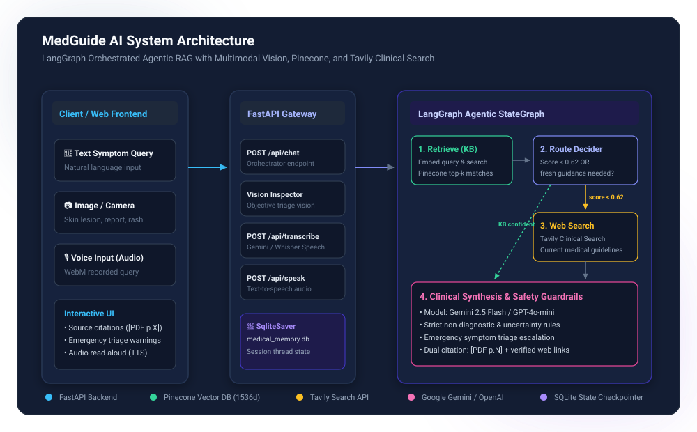
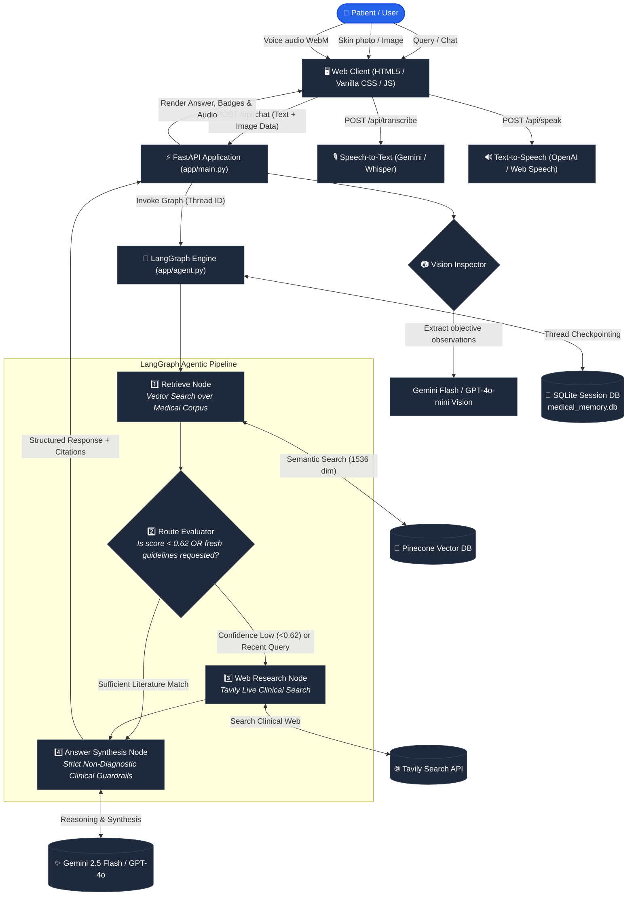

# 🩺 MedGuide AI — Multimodal Agentic Medical Assistant

<div align="center">

[](https://python.org)
[](https://fastapi.tiangolo.com)
[](https://langchain-ai.github.io/langgraph/)
[](https://www.pinecone.io/)
[](https://ai.google.dev/)
[](https://tavily.com/)
[](https://www.sqlite.org/)

<p align="center">
  <strong>An autonomous, multimodal clinical triage and medical education chatbot.</strong><br>
  Orchestrated with <strong>LangGraph</strong>, powered by <strong>Pinecone Vector RAG</strong>, <strong>Google Gemini / OpenAI</strong>, and <strong>Tavily AI Search</strong> with full voice and visual inspection capabilities.
</p>

[Key Features](#-key-features) • [System Architecture](#-system-architecture) • [Agent Workflow](#-agent-workflow) • [Project Structure](#-project-structure) • [Quick Start](#-quick-start) • [API Reference](#-api-reference) • [Medical Disclaimer](#-medical-disclaimer)

---

</div>

## 📌 Overview

**MedGuide AI** is an intelligent medical agent designed to bridge the gap between static medical encyclopedias and fast-evolving clinical research. Rather than acting as a static retrieval-augmented generation (RAG) pipeline, it employs an **agentic state graph** to dynamically evaluate its own knowledge, perform live external clinical web research when confidence is low or when queries demand recent medical guidelines, and integrate objective multimodal inputs (camera/images and voice).

Built with stringent **clinical safety guardrails**, MedGuide assists users with symptom education and triage advice without asserting unauthorized diagnoses or prescribing medications.

---

## 📸 System Architecture

<div align="center">
  
</div>

### Interactive Architecture Flow



---

## ✨ Key Features

- **🧠 Agentic Dynamic Routing**: Uses a `LangGraph` StateGraph to evaluate knowledge base relevance scores. If vector retrieval yields low confidence (`score < 0.62`) or the user asks for up-to-date guidance, it automatically spins up real-time clinical web search.
- **📚 Grounded Vector RAG**: Ingests authoritative medical literature and textbooks into a **Pinecone Serverless Vector Database** using Google Gemini 1536-dimensional embeddings.
- **📷 Multimodal Visual Triage**: Accepts uploads or live camera captures of skin rashes, physical presentations, or test excerpts. Operates strictly under objective, descriptive guidelines to prevent diagnostic overconfidence.
- **🎙️ Full Voice Interaction**: Direct browser audio recording with server-side transcription powered by Google Gemini / Whisper, plus synthetic speech narration.
- **💾 Persistent SQLite Memory**: Every conversation thread is tracked in `medical_memory.db` via `SqliteSaver`, preserving multi-turn context across messages.
- **🛡️ Medical Safety & Triage Protocols**:
  - Automatically identifies emergency red-flag symptoms (e.g., chest pain, stroke symptoms, acute breathing distress) and escalates directly to emergency services.
  - Cites historical literature with specific page markers (e.g. `[PDF p.42]`) alongside clickable verified web source links.
  - Transparently highlights outdated historical texts vs. current clinical guidelines.
- **💎 Glassmorphic Aesthetic**: Modern dark-mode interface featuring ambient glowing gradients, collapsible source badges, live status indicator, and mobile responsiveness.

---

## 🔄 Agent Workflow

The agentic pipeline is built with `StateGraph` in [`app/agent.py`](file:///d:/medical_agent/Medical_agentic_chatbot/app/agent.py):

| Node | Action | Logic & Conditions |
| :--- | :--- | :--- |
| **`retrieve`** | Knowledge Base Retrieval | Queries Pinecone for top-$k$ matches based on the user's question and visual observations. |
| **`route`** | Conditional Routing | Checks if the question contains freshness keywords (*"latest"*, *"current"*, *"2026"*, *"guideline"*, *"new treatment"*) or if top vector similarity $< 0.62$. Branches to **`web`** or directly to **`answer`**. |
| **`web`** | Clinical Web Research | Invokes Tavily's search engine targeting verified clinical guidelines, extracting titles, URLs, and snippet contents. |
| **`answer`** | Guardrailed Synthesis | Combines conversation history, image descriptions, PDF excerpts, and web sources into a grounded medical education response. |

---

## 📂 Project Structure

```
Medical_agentic_chatbot/
├── app/
│   ├── __init__.py           # Package marker
│   ├── agent.py              # LangGraph StateGraph, routing logic & SQLite memory
│   ├── config.py             # Pydantic Settings configuration & SSL certificate handler
│   ├── knowledge.py          # Pinecone vector index manager & Gemini embeddings
│   └── main.py               # FastAPI server, endpoints, multimodal & vision handlers
├── data/
│   └── medicalpdf.pdf        # Medical encyclopedia source corpus for RAG
├── static/
│   ├── app.js                # Frontend client logic (audio recording, camera, chat UI)
│   ├── architecture.svg      # High-resolution system architecture diagram
│   └── style.css             # Glassmorphic UI styles, ambient glow & responsive layout
├── templates/
│   └── index.html            # Single-page interface layout
├── .env.example              # Template for required environment variables
├── .gitignore                # Git exclusion rules
├── ingest.py                 # Document processing & Pinecone batch vector upsert script
├── medical_memory.db         # Persistent SQLite conversation checkpoint store
├── requirements.txt          # Python dependencies
└── README.md                 # Project documentation
```

---

## 🛠️ Tech Stack & Integrations

| Layer | Technology | Details |
| :--- | :--- | :--- |
| **Backend Framework** | [FastAPI](https://fastapi.tiangolo.com/) | Asynchronous web server with OpenAPI documentation |
| **Agent Orchestration** | [LangGraph](https://langchain-ai.github.io/langgraph/) | Cyclic state machine graph with conditional routing |
| **Vector Database** | [Pinecone](https://www.pinecone.io/) | Serverless index (`cosine` metric, 1536 dimensions) |
| **Embeddings** | [Google Gemini](https://ai.google.dev/) | `gemini-embedding-001` (output dimension: 1536) |
| **Primary LLM & Vision** | [Google Gemini](https://ai.google.dev/) | `gemini-flash-lite-latest` / `gemini-2.5-flash-lite` |
| **Fallback LLM & Vision** | [OpenAI](https://platform.openai.com/) | `gpt-4o-mini`, `whisper-1`, `tts-1` |
| **Clinical Search** | [Tavily](https://tavily.com/) | Agentic web research engine optimized for LLMs |
| **Session Memory** | [SQLite](https://www.sqlite.org/) | `SqliteSaver` persistent thread checkpointing |
| **PDF Processing** | [PyMuPDF (fitz)](https://pymupdf.readthedocs.io/) | Fast PDF page text extraction & chunking |
| **Frontend** | Vanilla JS & CSS | Native Camera API, MediaRecorder API, SpeechSynthesis |

---

## 🚀 Quick Start

### 1. Prerequisites
- **Python 3.10+**
- A **Pinecone** account & API key
- A **Google AI Studio (Gemini)** API key *(or OpenAI API key)*
- A **Tavily** API key for real-time web search

### 2. Clone and Setup Environment

```bash
# Clone the repository
git clone https://github.com/<your-username>/Medical_agentic_chatbot.git
cd Medical_agentic_chatbot

# Create a virtual environment
python -m venv venv

# Activate the virtual environment
# On Windows:
venv\Scripts\activate
# On macOS/Linux:
source venv/bin/activate

# Install required dependencies
pip install -r requirements.txt
```

### 3. Configure Environment Variables

Create your `.env` file from the provided `.env.example`:

```bash
cp .env.example .env
```

Populate the keys in `.env`:

```ini
# Primary AI Provider (Gemini)
GEMINI_API_KEY="your-google-gemini-api-key"

# Live Web Clinical Search
TAVILY_API_KEY="your-tavily-api-key"

# Vector Database (Pinecone)
PINECONE_API_KEY="your-pinecone-api-key"
PINECONE_INDEX="medical-chatbot"

# Optional Fallback / Speech:
OPENAI_API_KEY="your-openai-api-key"
API_TOKEN=""               # Optional Bearer token protection for API
ALLOWED_ORIGINS="*"        # CORS configuration
```

---

## 📖 Knowledge Base Ingestion

To populate your Pinecone vector database with reference medical literature, place your PDF inside the `data/` directory and run `ingest.py`:

```bash
# Ingest entire medical PDF
python ingest.py --pdf data/medicalpdf.pdf

# Or ingest a test subset (e.g. first 50 pages)
python ingest.py --pdf data/medicalpdf.pdf --max-pages 50
```

> **How it works:** `ingest.py` extracts text using `PyMuPDF`, splits text into 1100-character chunks with 180-character overlaps, computes 1536-dimensional embeddings with Gemini, and upserts batches of 50 vectors with deterministic SHA-256 identifiers to prevent duplicates.

---

## 🏃 Running the Application

Start the FastAPI application with Uvicorn:

```bash
uvicorn app.main:app --reload --host 127.0.0.1 --port 8000
```

Once running:
- **Interactive UI**: Open [http://127.0.0.1:8000](http://127.0.0.1:8000) in your browser.
- **Interactive API Documentation**: Explore Swagger UI at [http://127.0.0.1:8000/docs](http://127.0.0.1:8000/docs).

---

## 🔌 API Reference

### Health Check
```http
GET /api/health
```
**Response:**
```json
{
  "status": "ok",
  "configured": true,
  "tavily": true,
  "provider": "gemini"
}
```

---

### Chat / Clinical Agent Query
```http
POST /api/chat
Content-Type: application/json
X-Conversation-ID: optional-session-uuid-v4
```

**Request Body:**
```json
{
  "message": "What are the common clinical indicators of acute appendicitis and when is it an emergency?",
  "history": [
    {"role": "user", "content": "Hello doctor"},
    {"role": "assistant", "content": "Hello, how can I assist you with health questions today?"}
  ],
  "image_data": "data:image/jpeg;base64,..." 
}
```

**Response:**
```json
{
  "answer": "Acute appendicitis typically manifests with abdominal pain starting near the umbilicus and migrating to the right lower quadrant...",
  "sources": [
    {"type": "pdf", "page": 84, "score": 0.812},
    {"type": "web", "url": "https://www.ncbi.nlm.nih.gov/...", "title": "Clinical Practice Guidelines for Appendicitis"}
  ],
  "tools": ["pinecone", "tavily"],
  "conversation_id": "c1f2d3e4-..."
}
```

---

### Voice Audio Transcription
```http
POST /api/transcribe
Content-Type: multipart/form-data
```
Accepts an audio file (`.webm`, `.mp3`, `.wav`) under 10MB and returns transcribed text using Gemini or OpenAI Whisper.

---

### Text-to-Speech
```http
POST /api/speak
Content-Type: application/json
```
```json
{ "text": "Text to read aloud" }
```
Returns an `audio/mpeg` stream.

---

## ⚠️ Medical Disclaimer

> **IMPORTANT CLINICAL & EDUCATIONAL NOTICE**
> 
> MedGuide AI is developed strictly for **educational and informative triage guidance**. It does **NOT** provide medical diagnoses, replace certified physician consultations, or prescribe dosages/medications.
>
> If you or someone around you is experiencing life-threatening symptoms—including acute chest pressure, difficulty breathing, sudden paralysis or stroke signs, severe trauma, or uncontrollable bleeding—**contact your local emergency services (e.g. 911, 112, 999) or visit the nearest emergency department immediately**.

---

<div align="center">
  <sub>Built with ❤️ for accessible healthcare education & agentic AI research.</sub>
</div>